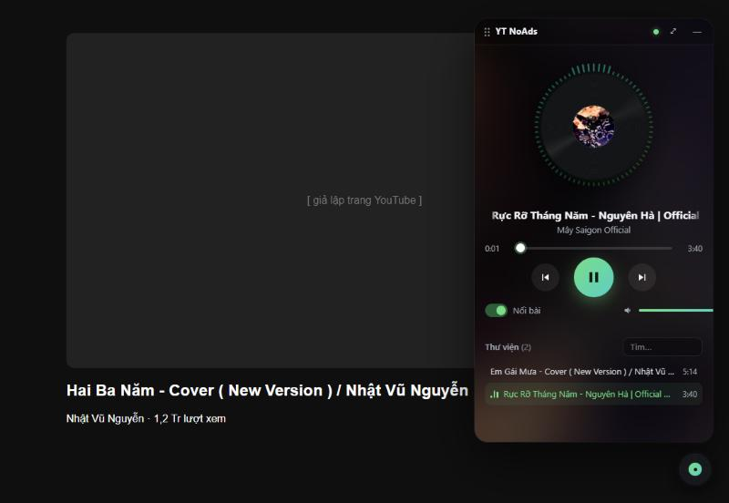
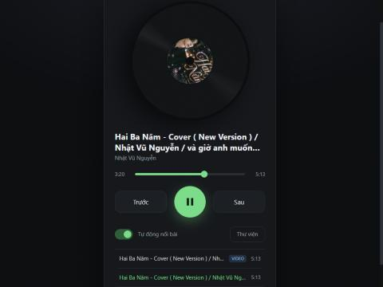
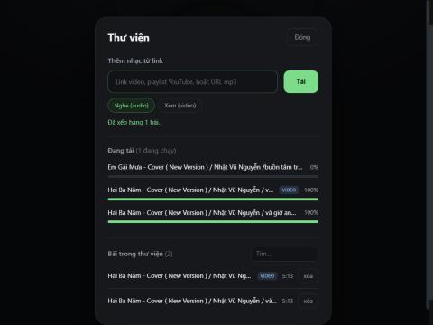
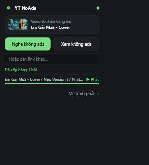

<div align="center">


# YT NoAds Player

**Save YouTube videos to your own computer, then listen or watch them ad-free — right on top of YouTube.**

English · [Tiếng Việt](README.vi.md)




</div>

> [!IMPORTANT]
> Personal-use tool. Downloading content from YouTube may violate the
> [YouTube Terms of Service](https://www.youtube.com/t/terms) and the rights of creators.
> Only download content you have the right to, and support artists when you can.
> This project is **not** affiliated with YouTube or Google and is not distributed on the Chrome Web Store
> (store policy does not allow YouTube downloaders) — see [FAQ](#faq).

---

## Contents

- [Features](#features)
- [How it works](#how-it-works)
- [Requirements](#requirements)
- [Installation](#installation)
- [Usage](#usage)
- [Configuration](#configuration)
- [Troubleshooting](#troubleshooting)
- [Security & privacy](#security--privacy)
- [Project structure](#project-structure)
- [Development](#development)
- [FAQ](#faq)
- [Support](#support)
- [License](#license)

## Features

| | |
|---|---|
| 🎛️ **Floating player on YouTube** | A vinyl button sits in the corner of every YouTube page. Open it into a draggable panel that keeps playing while you browse. |
| ✨ **Effects** | Spinning vinyl with cover art, audio-reactive visualizer ring (Web Audio), bass-driven glow, ambient background from the cover, marquee titles, animated track changes. |
| ⚡ **One-click "listen ad-free"** | The panel detects the video you're on → **Listen** / **Watch** → downloads and auto-plays when ready. |
| 📚 **Library** | Add single videos, whole playlists (`/playlist?list=…`) or direct mp3 URLs. Download queue with progress, search, delete. |
| 🎧 **Audio or video** | *Listen* saves light m4a audio; *Watch* saves mp4 up to 720p (configurable). |
| 🔇 **No clashes** | While the mini player plays, YouTube's own video (including autoplaying ads) is paused. |
| ⌨️ **Shortcuts** | Right-click menu, `Alt+Shift+A`, media keys (Media Session), `Space` / `←` `→` / `N` `P` in the player. |
| 📴 **Offline** | Everything you saved plays without a connection. |
| 🌐 **i18n** | Extension name, description and menus in English & Vietnamese (follows the browser language). |

<table>
<tr>
<td></td>
<td></td>
<td></td>
</tr>
<tr>
<td align="center">Full-tab player</td>
<td align="center">Library &amp; download queue</td>
<td align="center">Toolbar popup</td>
</tr>
</table>

## How it works

A browser extension cannot download YouTube streams by itself (signatures, PO tokens, separate
audio/video tracks). So the project has two parts that talk over `localhost`:

```text
┌──────────────── Browser ────────────────┐         ┌──────────── Your computer ────────────┐
│ YouTube page                             │         │ helper (FastAPI + yt-dlp)             │
│  └─ content.js → floating panel (iframe) │  HTTP   │  127.0.0.1:8765                       │
│ Toolbar popup · Full-tab player          │ ──────▶ │  • resolves links / playlists         │
│ Right-click menu · shortcut              │ ◀────── │  • download queue (yt-dlp, ffmpeg)    │
└──────────────────────────────────────────┘  media  │  • library.json + media files         │
                                                     └───────────────────────────────────────┘
```

The extension never talks to any server other than the helper on your own machine.

## Requirements

| Need | Why | Install |
|---|---|---|
| Chrome / Edge / Brave / Cốc Cốc (Chromium ≥ 116) | runs the extension | — |
| **Python 3.11+** | runs the helper | [python.org](https://www.python.org/downloads/) (tick *Add to PATH*) |
| **Node.js or Deno** | yt-dlp needs a JavaScript runtime for YouTube | Windows: `winget install OpenJS.NodeJS.LTS` · macOS: `brew install node` |
| **ffmpeg** *(recommended)* | merges 720p video + audio | Windows: `winget install Gyan.FFmpeg` · macOS: `brew install ffmpeg` · Debian/Ubuntu: `sudo apt install ffmpeg` |

Without ffmpeg, audio still works and video falls back to ~360p.

## Installation

1. **Get the code** — download `yt-noads-player-<version>.zip` from the Releases page and unzip it,
   or clone this repository. Keep it in a permanent folder (e.g. `C:\Users\<you>\Apps\yt-noads-player`):
   the browser loads the extension from that folder.

2. **Start the helper**
   - Windows: double-click `helper\start.bat` (first run creates a virtualenv and installs dependencies).
   - macOS / Linux: `./helper/start.sh`

   The window shows the address `http://127.0.0.1:8765` — keep it open. Check: open
   <http://127.0.0.1:8765/api/health> — it returns `"ok": true`.

3. **Load the extension**
   1. Open `chrome://extensions` (Edge: `edge://extensions`).
   2. Turn on **Developer mode**.
   3. Click **Load unpacked** → select the `extension` folder.
   4. Pin the vinyl icon to the toolbar.

4. **(Optional, Windows) start the helper automatically at sign-in, hidden:**

   ```powershell
   powershell -ExecutionPolicy Bypass -File helper\install-autostart.ps1
   ```

   This creates a "YT NoAds Helper" shortcut in `shell:startup`. Delete it to undo.
   Logs go to `%USERPROFILE%\YTNoAdsPlayer\helper.log`.

5. Open (or reload) any YouTube page — the vinyl button appears in the bottom-right corner.

## Usage

| Where | What to do |
|---|---|
| **Floating player** (vinyl button on YouTube) | Click to open. The *Video on this page* card → **Nghe** (listen) / **Xem** (watch) → auto-plays when downloaded. Drag the title bar to move; **—** hides it (music keeps playing); **⤢** opens the full-tab player. |
| **Toolbar popup** | On a YouTube video: **Nghe không ads** (listen) / **Xem không ads** (watch), progress, **▶ Phát** (play); paste any other link; toggle the floating player. |
| **Full-tab player** | *Mở trình phát →* in the popup. **Thư viện** (Library) → paste a video / playlist / mp3 URL → **Tải**. Search and delete tracks. |
| **Right-click** a page or link | *YT NoAds: add to listen / add to watch*. The icon badge shows `+1` when queued. |
| `Alt+Shift+A` | Add the YouTube page you're on (audio). Change it at `chrome://extensions/shortcuts`. |
| Player keys | `Space` play/pause · `←` `→` seek 5 s · `N` / `P` next / previous · double-click video = fullscreen. |

Notes:

- A `watch?v=…&list=…` link adds only that video; paste the playlist page link (`/playlist?list=…`) to add the whole playlist (max 200 items by default).
- Items already in the library (same mode) are skipped.
- Each YouTube tab has its own floating player; a full page reload (F5) stops it, navigating inside YouTube does not.
- The player UI text is currently Vietnamese; extension name and menus follow your browser language (EN/VI).

## Configuration

Copy `helper/.env.example` to `helper/.env` and edit:

| Variable | Default | Meaning |
|---|---|---|
| `YTP_DATA_DIR` | `~/YTNoAdsPlayer` | Where `library.json`, `media/` and `helper.log` live |
| `YTP_PORT` | `8765` | Helper port (also update `HELPER` in `extension/api.js` and `host_permissions` in `manifest.json`) |
| `YTP_MAX_VIDEO_HEIGHT` | `720` | Max height for *Watch* downloads (144–2160) |
| `YTP_MAX_PARALLEL_DOWNLOADS` | `2` | Concurrent downloads (1–6) |
| `YTP_MAX_PLAYLIST_ITEMS` | `200` | Max items taken from a playlist |

Restart the helper after changing `.env`.

## Troubleshooting

| Symptom | Fix |
|---|---|
| "Chưa kết nối helper" / red dot | The helper isn't running. Start `helper/start.bat` (or `start.sh`), then click **Thử lại** (retry). |
| Downloads suddenly fail for every video | YouTube changed something. Update yt-dlp: `helper\update-yt-dlp.bat` (or `.venv/bin/pip install -U "yt-dlp[default]"`), then restart the helper. |
| "This video is unavailable" / "Sign in to confirm your age" | Private, age-restricted or region-locked video — not supported. |
| Errors mentioning a JavaScript runtime / n-challenge | Install Node.js or Deno and restart the helper. |
| Video downloads are only ~360p | ffmpeg not found — install it and restart the helper (`/api/health` shows `"ffmpeg": true`). |
| Floating button doesn't appear | Reload the extension in `chrome://extensions`, then reload the YouTube tab (F5). |
| Visualizer ring doesn't move | Update the helper to ≥ 1.2.0 (it must send CORS headers to the extension). Playback still works without it. |

## Security & privacy

- The helper binds to **127.0.0.1 only** — other devices on your network can't reach it.
- Requests carrying a web-page `Origin` are rejected (HTTP 403): websites can't trigger downloads or
  delete your library. Only the extension's own origin is allowed.
- Only `http(s)://` links are accepted; titles are rendered with `textContent` (no HTML injection).
- No analytics, no accounts, no remote servers. The only network traffic is yt-dlp fetching the
  media you asked for, and cover thumbnails loaded from `i.ytimg.com`.
- Extension permissions: `contextMenus`, `activeTab`, `storage`, host access to `127.0.0.1:8765`,
  and a content script on `youtube.com` for the floating player.

## Project structure

```text
yt-noads-player/
├── extension/                  Chrome MV3 extension
│   ├── manifest.json
│   ├── _locales/{en,vi}/       i18n strings (name, description, menus)
│   ├── background.js           service worker: context menu, shortcut, opens player
│   ├── content.js              injects the floating button + panel on YouTube (Shadow DOM)
│   ├── mini.html/.css/.js      floating player (visualizer, ambient, add-this-video)
│   ├── popup.html/.css/.js     toolbar popup
│   ├── player.html/.css/.js    full-tab player + library
│   └── api.js                  tiny client for the helper API
├── helper/                     local helper (FastAPI + yt-dlp)
│   ├── app/
│   │   ├── main.py             app factory, routers, middleware
│   │   ├── config.py           settings (YTP_* env vars)
│   │   ├── core/               origin check, exceptions, dependencies
│   │   ├── routers/            /api/tracks, /api/downloads, /media
│   │   ├── services/           download queue (yt-dlp)
│   │   ├── repositories/       JSON library store
│   │   └── schemas/            Pydantic models
│   ├── tests/
│   ├── start.bat · start.sh · update-yt-dlp.bat · install-autostart.ps1
│   └── requirements.txt
├── scripts/package.ps1         builds release zips into dist/
└── docs/screenshots/
```

### Helper API

| Method | Path | Description |
|---|---|---|
| `GET` | `/api/health` | Status, yt-dlp version, ffmpeg availability, data dir |
| `GET` | `/api/tracks` | Library (newest first) |
| `DELETE` | `/api/tracks/{id}` | Remove a track and its file |
| `POST` | `/api/downloads` | `{ "url": "...", "mode": "audio" \| "video" }` → queue |
| `GET` | `/api/downloads` | Queue progress + `library_version` |
| `GET` | `/media/{id}` | Stream the file (supports HTTP Range) |

## Development

```bash
cd helper
python -m venv .venv
.venv/Scripts/pip install -r requirements-dev.txt     # macOS/Linux: .venv/bin/pip
.venv/Scripts/python -m pytest -q
.venv/Scripts/python -m app                            # run the helper in the foreground
```

- After editing the extension, click ↻ on its card in `chrome://extensions` and reload YouTube tabs.
- Build release zips (Windows PowerShell): `powershell -File scripts/package.ps1` → `dist/`.
- CI (`.github/workflows/test.yml`) runs helper tests and checks extension syntax / JSON.
- Bump `version` in `extension/manifest.json` and add an entry to [CHANGELOG.md](CHANGELOG.md) for each release.

## FAQ

**Why isn't this on the Chrome Web Store?**
Store policy does not allow extensions that download YouTube videos, and the store can't ship the
Python helper anyway. Install it with *Load unpacked* as described above.

**Does it block ads while I watch on youtube.com?**
No. It plays *your saved copy* instead of YouTube's stream, so there are no ads in it. For ad-free
viewing on YouTube itself, consider YouTube Premium.

**Where are my files?**
In `~/YTNoAdsPlayer/media` (Windows: `C:\Users\<you>\YTNoAdsPlayer\media`). They are plain
`.m4a` / `.mp4` files you can open in any player.

**Firefox?**
Not tested. The code is Manifest V3 and mostly portable, but Firefox MV3 differences
(background scripts, `runtime.getContexts`) would need work. PRs welcome.

## Support

If this saves you time, you can support development:

[](https://github.com/sponsors/KhaiTrang1995)
[](https://buymeacoffee.com/techspherex)

Stars, bug reports and pull requests are just as welcome.

## License

[MIT](LICENSE). yt-dlp is released under [The Unlicense](https://github.com/yt-dlp/yt-dlp/blob/master/LICENSE);
FastAPI, Uvicorn and Pydantic under MIT.
