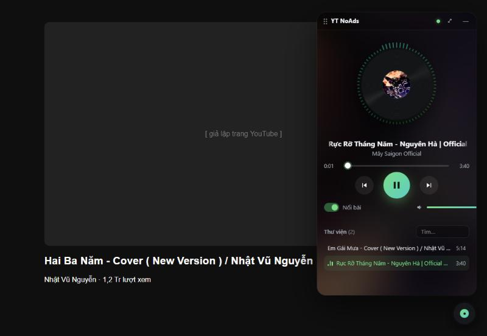
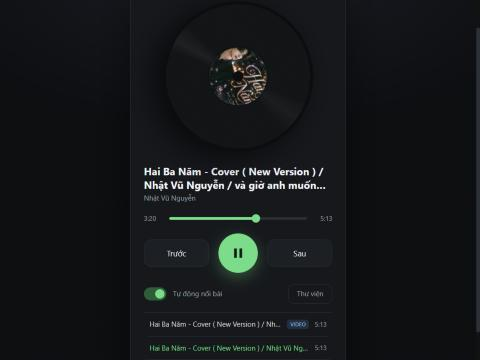
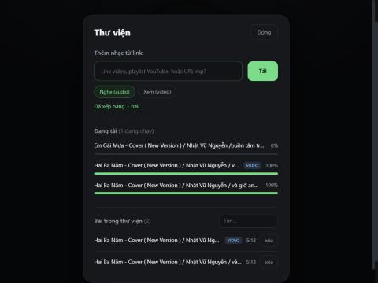
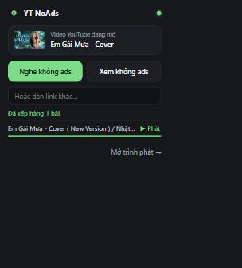

<div align="center">


# YT NoAds Player

**Lưu video YouTube về máy rồi nghe / xem không quảng cáo — ngay trên giao diện YouTube.**

[English](README.md) · Tiếng Việt




</div>

> [!IMPORTANT]
> Công cụ dùng cho mục đích cá nhân. Tải nội dung từ YouTube có thể vi phạm
> [Điều khoản dịch vụ của YouTube](https://www.youtube.com/t/terms) và quyền của người sáng tạo.
> Chỉ tải nội dung bạn có quyền, và ủng hộ nghệ sĩ khi có thể.
> Dự án **không** liên kết với YouTube hay Google và không phát hành trên Chrome Web Store
> (chính sách cửa hàng không cho phép công cụ tải YouTube) — xem [Hỏi đáp](#hỏi-đáp).

---

## Mục lục

- [Tính năng](#tính-năng)
- [Cách hoạt động](#cách-hoạt-động)
- [Yêu cầu](#yêu-cầu)
- [Cài đặt](#cài-đặt)
- [Sử dụng](#sử-dụng)
- [Cấu hình](#cấu-hình)
- [Xử lý sự cố](#xử-lý-sự-cố)
- [Bảo mật & quyền riêng tư](#bảo-mật--quyền-riêng-tư)
- [Cấu trúc dự án](#cấu-trúc-dự-án)
- [Phát triển](#phát-triển)
- [Hỏi đáp](#hỏi-đáp)
- [Giấy phép](#giấy-phép)

## Tính năng

| | |
|---|---|
| 🎛️ **Trình phát nổi trên YouTube** | Nút đĩa than ở góc mọi trang YouTube. Mở ra thành khung kéo thả được, nhạc vẫn chạy khi bạn lướt YouTube. |
| ✨ **Hiệu ứng** | Đĩa than xoay kèm ảnh bìa, vòng visualizer nhảy theo nhạc (Web Audio), phát sáng theo bass, nền ambient từ ảnh bìa, tên bài chạy chữ, chuyển bài có hiệu ứng. |
| ⚡ **Một chạm "nghe không ads"** | Khung tự nhận video đang mở → **Nghe** / **Xem** → tải xong tự phát. |
| 📚 **Thư viện** | Thêm video lẻ, cả playlist (`/playlist?list=…`) hoặc URL mp3. Hàng đợi tải có tiến độ, tìm kiếm, xóa. |
| 🎧 **Nghe hoặc xem** | *Nghe* lưu audio m4a nhẹ; *Xem* lưu mp4 tối đa 720p (chỉnh được). |
| 🔇 **Không lẫn tiếng** | Khi trình phát nổi đang chạy, video của YouTube (kể cả quảng cáo tự chạy) sẽ tự dừng. |
| ⌨️ **Phím tắt** | Menu chuột phải, `Alt+Shift+A`, phím media (Media Session), `Space` / `←` `→` / `N` `P` trong player. |
| 📴 **Offline** | Bài đã lưu phát được khi không có mạng. |
| 🌐 **Đa ngôn ngữ** | Tên, mô tả và menu extension có tiếng Anh & tiếng Việt (theo ngôn ngữ trình duyệt). |

<table>
<tr>
<td></td>
<td></td>
<td></td>
</tr>
<tr>
<td align="center">Trình phát toàn trang</td>
<td align="center">Thư viện &amp; hàng đợi tải</td>
<td align="center">Popup thanh công cụ</td>
</tr>
</table>

## Cách hoạt động

Extension không tự tải được luồng YouTube (chữ ký, PO token, audio/video tách rời). Vì vậy dự án
gồm hai phần nói chuyện với nhau qua `localhost`:

```text
┌──────────────── Trình duyệt ─────────────┐         ┌──────────── Máy của bạn ──────────────┐
│ Trang YouTube                            │         │ helper (FastAPI + yt-dlp)             │
│  └─ content.js → khung nổi (iframe)      │  HTTP   │  127.0.0.1:8765                       │
│ Popup thanh công cụ · Player toàn trang  │ ──────▶ │  • đọc link / playlist                │
│ Menu chuột phải · phím tắt               │ ◀────── │  • hàng đợi tải (yt-dlp, ffmpeg)      │
└──────────────────────────────────────────┘  media  │  • library.json + file media          │
                                                     └───────────────────────────────────────┘
```

Extension không gửi dữ liệu tới máy chủ nào ngoài helper trên chính máy bạn.

## Yêu cầu

| Cần | Để làm gì | Cài |
|---|---|---|
| Chrome / Edge / Brave / Cốc Cốc (Chromium ≥ 116) | chạy extension | — |
| **Python 3.11+** | chạy helper | [python.org](https://www.python.org/downloads/) (tích *Add to PATH*) |
| **Node.js hoặc Deno** | yt-dlp cần JavaScript runtime để xử lý YouTube | Windows: `winget install OpenJS.NodeJS.LTS` · macOS: `brew install node` |
| **ffmpeg** *(nên có)* | ghép video 720p + audio | Windows: `winget install Gyan.FFmpeg` · macOS: `brew install ffmpeg` · Debian/Ubuntu: `sudo apt install ffmpeg` |

Không có ffmpeg: audio vẫn tải bình thường, video chỉ còn khoảng 360p.

## Cài đặt

1. **Lấy mã nguồn** — tải `yt-noads-player-<version>.zip` ở trang Releases rồi giải nén, hoặc clone repo.
   Đặt ở thư mục cố định (vd. `C:\Users\<bạn>\Apps\yt-noads-player`) — trình duyệt nạp extension từ chính thư mục này.

2. **Chạy helper**
   - Windows: nhấp đúp `helper\start.bat` (lần đầu tự tạo virtualenv và cài thư viện).
   - macOS / Linux: `./helper/start.sh`

   Cửa sổ hiện địa chỉ `http://127.0.0.1:8765` — để nguyên cửa sổ đó. Kiểm tra: mở
   <http://127.0.0.1:8765/api/health> — trả về `"ok": true`.

3. **Nạp extension**
   1. Mở `chrome://extensions` (Edge: `edge://extensions`).
   2. Bật **Developer mode** (Chế độ dành cho nhà phát triển).
   3. Bấm **Load unpacked** (Tải tiện ích đã giải nén) → chọn thư mục `extension`.
   4. Ghim icon đĩa than ra thanh công cụ.

4. **(Tùy chọn, Windows) cho helper tự chạy ẩn khi đăng nhập:**

   ```powershell
   powershell -ExecutionPolicy Bypass -File helper\install-autostart.ps1
   ```

   Lệnh tạo shortcut "YT NoAds Helper" trong `shell:startup`; xóa shortcut đó để gỡ.
   Log ghi vào `%USERPROFILE%\YTNoAdsPlayer\helper.log`.

5. Mở (hoặc tải lại) trang YouTube bất kỳ — nút đĩa than xuất hiện ở góc phải dưới.

## Sử dụng

| Ở đâu | Làm gì |
|---|---|
| **Trình phát nổi** (nút đĩa than trên YouTube) | Bấm để mở. Thẻ *Video đang mở* → **Nghe** / **Xem** → tải xong tự phát. Kéo thanh tiêu đề để di chuyển; **—** thu nhỏ (nhạc vẫn chạy); **⤢** mở trình phát toàn trang. |
| **Popup thanh công cụ** | Trên video YouTube: **Nghe không ads** / **Xem không ads**, tiến độ, **▶ Phát**; dán link khác; bật/tắt trình phát nổi. |
| **Trình phát toàn trang** | *Mở trình phát →* trong popup. **Thư viện** → dán link video / playlist / mp3 → **Tải**. Tìm và xóa bài. |
| **Chuột phải** lên trang hoặc link | *YT NoAds: thêm để nghe / thêm để xem*. Icon hiện `+1` khi đã xếp hàng. |
| `Alt+Shift+A` | Thêm trang YouTube đang mở (nghe). Đổi phím ở `chrome://extensions/shortcuts`. |
| Phím trong player | `Space` phát/dừng · `←` `→` tua 5 giây · `N` / `P` bài sau / trước · nhấp đúp video = toàn màn hình. |

Lưu ý:

- Link `watch?v=…&list=…` chỉ lấy video đó; muốn cả playlist thì dán link trang playlist (`/playlist?list=…`), mặc định tối đa 200 bài.
- Bài đã có trong thư viện (cùng kiểu Nghe/Xem) sẽ được bỏ qua.
- Mỗi tab YouTube có trình phát nổi riêng; tải lại hẳn trang (F5) thì nhạc dừng, chuyển video trong YouTube thì không.
- Giao diện player hiện bằng tiếng Việt; tên extension và menu theo ngôn ngữ trình duyệt (EN/VI).

## Cấu hình

Sao chép `helper/.env.example` thành `helper/.env` rồi chỉnh:

| Biến | Mặc định | Ý nghĩa |
|---|---|---|
| `YTP_DATA_DIR` | `~/YTNoAdsPlayer` | Nơi lưu `library.json`, `media/` và `helper.log` |
| `YTP_PORT` | `8765` | Cổng helper (đổi thì sửa cả `HELPER` trong `extension/api.js` và `host_permissions` trong `manifest.json`) |
| `YTP_MAX_VIDEO_HEIGHT` | `720` | Độ phân giải tối đa khi *Xem* (144–2160) |
| `YTP_MAX_PARALLEL_DOWNLOADS` | `2` | Số lượt tải song song (1–6) |
| `YTP_MAX_PLAYLIST_ITEMS` | `200` | Số bài tối đa lấy từ một playlist |

Khởi động lại helper sau khi sửa `.env`.

## Xử lý sự cố

| Hiện tượng | Cách xử lý |
|---|---|
| "Chưa kết nối helper" / chấm đỏ | Helper chưa chạy. Mở `helper/start.bat` (hoặc `start.sh`) rồi bấm **Thử lại**. |
| Đột nhiên video nào cũng tải lỗi | YouTube vừa thay đổi. Cập nhật yt-dlp: `helper\update-yt-dlp.bat` (hoặc `.venv/bin/pip install -U "yt-dlp[default]"`), rồi khởi động lại helper. |
| "This video is unavailable" / "Sign in to confirm your age" | Video riêng tư, giới hạn tuổi hoặc chặn theo vùng — không hỗ trợ. |
| Lỗi nhắc tới JavaScript runtime / n-challenge | Cài Node.js hoặc Deno rồi khởi động lại helper. |
| Video tải về chỉ ~360p | Không tìm thấy ffmpeg — cài vào rồi khởi động lại helper (`/api/health` báo `"ffmpeg": true`). |
| Không thấy nút đĩa than | Reload extension trong `chrome://extensions`, rồi tải lại tab YouTube (F5). |
| Vòng visualizer đứng yên | Cập nhật helper lên ≥ 1.2.0 (cần gửi header CORS cho extension). Không có thì nhạc vẫn phát. |

## Bảo mật & quyền riêng tư

- Helper chỉ lắng nghe trên **127.0.0.1** — máy khác trong mạng không truy cập được.
- Request mang `Origin` của trang web bị từ chối (HTTP 403): trang web không thể tự tải bài hay xóa thư viện của bạn.
  Chỉ origin của chính extension được phép.
- Chỉ nhận link `http(s)://`; tiêu đề hiển thị bằng `textContent` (không chèn được HTML).
- Không analytics, không tài khoản, không máy chủ ngoài. Lưu lượng mạng duy nhất là yt-dlp tải nội dung
  bạn yêu cầu, và ảnh bìa lấy từ `i.ytimg.com`.
- Quyền của extension: `contextMenus`, `activeTab`, `storage`, truy cập `127.0.0.1:8765`,
  và content script trên `youtube.com` cho trình phát nổi.

## Cấu trúc dự án

```text
yt-noads-player/
├── extension/                  Extension Chrome MV3
│   ├── manifest.json
│   ├── _locales/{en,vi}/       chuỗi đa ngôn ngữ (tên, mô tả, menu)
│   ├── background.js           service worker: menu chuột phải, phím tắt, mở player
│   ├── content.js              chèn nút nổi + khung vào YouTube (Shadow DOM)
│   ├── mini.html/.css/.js      trình phát nổi (visualizer, ambient, thêm video đang mở)
│   ├── popup.html/.css/.js     popup thanh công cụ
│   ├── player.html/.css/.js    trình phát toàn trang + thư viện
│   └── api.js                  client gọi API helper
├── helper/                     helper chạy trên máy (FastAPI + yt-dlp)
│   ├── app/
│   │   ├── main.py             tạo app, router, middleware
│   │   ├── config.py           cấu hình (biến môi trường YTP_*)
│   │   ├── core/               kiểm tra origin, exception, dependency
│   │   ├── routers/            /api/tracks, /api/downloads, /media
│   │   ├── services/           hàng đợi tải (yt-dlp)
│   │   ├── repositories/       lưu thư viện dạng JSON
│   │   └── schemas/            model Pydantic
│   ├── tests/
│   ├── start.bat · start.sh · update-yt-dlp.bat · install-autostart.ps1
│   └── requirements.txt
├── scripts/package.ps1         đóng gói file zip phát hành vào dist/
└── docs/screenshots/
```

### API của helper

| Method | Path | Mô tả |
|---|---|---|
| `GET` | `/api/health` | Trạng thái, phiên bản yt-dlp, có ffmpeg không, thư mục dữ liệu |
| `GET` | `/api/tracks` | Thư viện (mới nhất trước) |
| `DELETE` | `/api/tracks/{id}` | Xóa bài và file |
| `POST` | `/api/downloads` | `{ "url": "...", "mode": "audio" \| "video" }` → xếp hàng |
| `GET` | `/api/downloads` | Tiến độ hàng đợi + `library_version` |
| `GET` | `/media/{id}` | Phát file (hỗ trợ HTTP Range để tua) |

## Phát triển

```bash
cd helper
python -m venv .venv
.venv/Scripts/pip install -r requirements-dev.txt     # macOS/Linux: .venv/bin/pip
.venv/Scripts/python -m pytest -q
.venv/Scripts/python -m app                            # chạy helper ở foreground
```

- Sửa extension xong: bấm ↻ ở thẻ extension trong `chrome://extensions` và tải lại tab YouTube.
- Đóng gói bản phát hành (Windows PowerShell): `powershell -File scripts/package.ps1` → thư mục `dist/`.
- CI (`.github/workflows/test.yml`) chạy test helper và kiểm tra cú pháp / JSON của extension.
- Mỗi lần phát hành: tăng `version` trong `extension/manifest.json` và ghi vào [CHANGELOG.md](CHANGELOG.md).

## Hỏi đáp

**Sao không có trên Chrome Web Store?**
Chính sách cửa hàng không cho phép extension tải video YouTube, và cửa hàng cũng không phát hành được
helper Python. Hãy cài bằng *Load unpacked* như hướng dẫn ở trên.

**Nó có chặn quảng cáo khi xem trực tiếp trên youtube.com không?**
Không. Nó phát *bản bạn đã lưu* thay cho luồng của YouTube, nên không có quảng cáo trong đó.
Muốn xem YouTube không quảng cáo ngay trên trang, hãy cân nhắc YouTube Premium.

**File của tôi ở đâu?**
Ở `~/YTNoAdsPlayer/media` (Windows: `C:\Users\<bạn>\YTNoAdsPlayer\media`). Đó là file
`.m4a` / `.mp4` bình thường, mở bằng trình phát nào cũng được.

**Firefox thì sao?**
Chưa thử. Mã nguồn là Manifest V3 và phần lớn dùng lại được, nhưng Firefox MV3 khác ở vài chỗ
(background script, `runtime.getContexts`) nên cần chỉnh thêm. Rất hoan nghênh PR.

## Giấy phép

[MIT](LICENSE). yt-dlp phát hành theo [The Unlicense](https://github.com/yt-dlp/yt-dlp/blob/master/LICENSE);
FastAPI, Uvicorn và Pydantic theo MIT.
